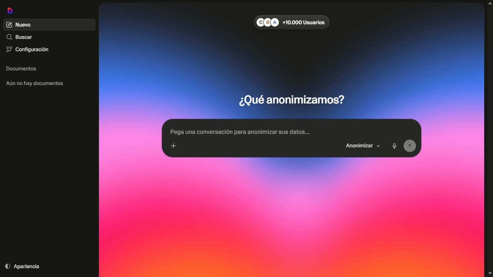
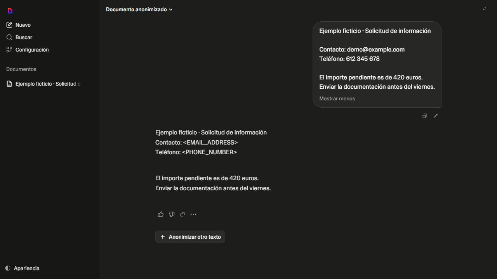
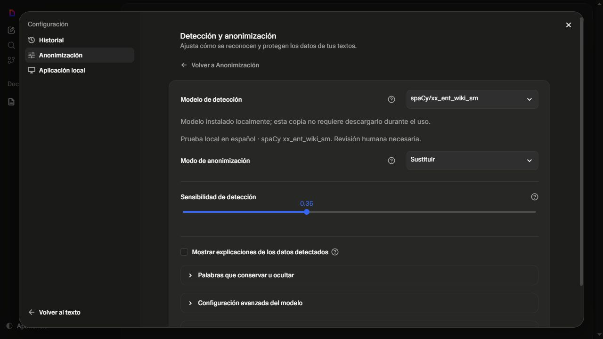

[English](README.md) | **Español**

<div align="center">

# Anonimizar

**Revisa tus textos antes de compartirlos.**

Una aplicación para Windows que ayuda a detectar y sustituir datos identificativos en texto en español. Pega, revisa y copia el resultado, con el motor ejecutándose en tu ordenador.

**La interfaz de la aplicación y el procesamiento están orientados a textos en español.** La presentación del repositorio está disponible en inglés y en español.

**[Descargar para Windows x64 →](https://github.com/guillemarcos14/Anonimizar/releases/download/v0.3.0/Anonimizar-Setup-0.3.0-win-x64.exe)**

Versión preliminar **0.3.0** · Incluye motor y modelo · Sin cuenta en la aplicación

[Notas de la versión](https://github.com/guillemarcos14/Anonimizar/releases/tag/v0.3.0) · [Comprobar SHA-256](https://github.com/guillemarcos14/Anonimizar/releases/download/v0.3.0/Anonimizar-Setup-0.3.0-win-x64.exe.sha256)

</div>



*Pantalla de inicio, antes de introducir texto.*



*Captura real con datos ficticios. En este ejemplo se sustituyen el correo y el teléfono; el importe y las instrucciones se conservan. Toda salida necesita revisión humana.*

## Qué puedes hacer

- **Preparar una copia del texto:** detectar y sustituir identificadores como correos y teléfonos mediante Presidio.
- **Revisar antes de compartir:** consultar el original y el resultado, comprobar las sustituciones y copiar o descargar la salida.
- **Retomar documentos:** recuperar original y revisión desde el historial local, exportar copias y gestionar la papelera.
- **Ajustar la detección:** elegir el modo de anonimización, la sensibilidad y las palabras que conservar u ocultar.



*Los controles permiten adaptar el procesamiento; su disponibilidad no garantiza que todos los tipos de datos se detecten correctamente.*

## Instalar y empezar

**Requisitos:** Windows x64 y .NET Framework 4.6.2 o posterior. El instalador incluye Python, las dependencias y el modelo; no tienes que instalarlos por separado ni usar una terminal.

1. **[Descarga el instalador de Windows](https://github.com/guillemarcos14/Anonimizar/releases/download/v0.3.0/Anonimizar-Setup-0.3.0-win-x64.exe)** y ejecútalo. Confirma la instalación para tu usuario.
2. **Abre Anonimizar** desde el escritorio o Inicio. La interfaz se abre en el navegador y el motor se ejecuta en el ordenador.
3. **Pega tu texto, envíalo y revisa el resultado.** Comprueba omisiones y sustituciones incorrectas antes de copiarlo o compartirlo. Límite provisional: **10.000 caracteres**.

El instalador **no tiene firma de editor**; Windows puede mostrar una advertencia. Puedes comparar su hash con el [archivo SHA-256 de la release](https://github.com/guillemarcos14/Anonimizar/releases/download/v0.3.0/Anonimizar-Setup-0.3.0-win-x64.exe.sha256). El hash comprueba integridad, no sustituye una firma.

Para detener el motor, utiliza **Configuración → Cerrar Anonimizar y detener el motor**. Cerrar solo la pestaña lo deja activo.

## Privacidad y límites

- **Procesamiento local:** el motor funciona en tu ordenador. No se promete ausencia universal de conexiones externas; consulta [uso y privacidad](LOCAL.md).
- **Historial activado por defecto:** conserva original, ajustes y revisión en `%LOCALAPPDATA%\Anonimizar`. Puedes desactivarlo en Configuración; eso no elimina documentos anteriores. No hay cifrado local propio.
- **Revisión humana obligatoria:** puede haber omisiones, falsos positivos y detalles indirectos que identifiquen a alguien. No se garantiza anonimización completa o irreversible.
- **Versión preliminar:** comprobada con datos ficticios en un equipo Windows, incluidos instalación aislada, modelo e historial, desinstalación y reinstalación. La integración habitual de Windows, sus diálogos y otro equipo siguen pendientes.

El código es público. La licencia global de las aportaciones propias y algunos permisos de recursos visuales siguen pendientes; se conservan las atribuciones y condiciones existentes. Consulta [LICENCIAS.md](LICENCIAS.md), [CONDICIONES-ENTREGA.md](CONDICIONES-ENTREGA.md) y el [estado de validación](PREPARACION.md).

## Desarrollo y documentación

<details>
<summary><strong>Ejecutar desde el código y construir el instalador</strong></summary>

Se requiere **CPython 3.13.7 x64**. Desde PowerShell, en la carpeta del repositorio:

```powershell
.\descargar-dependencias.ps1 -Python 'C:\ruta\Python313\python.exe'
.\instalar.ps1 -Python 'C:\ruta\Python313\python.exe'
.\iniciar.ps1
```

La descarga obtiene las dependencias fijadas y el modelo desde fuentes públicas y comprueba sus hashes. La instalación posterior usa el kit local y crea `.venv`; no sobrescribe un entorno existente.

Para construir, con ese entorno instalado y el compilador .NET Framework de Windows:

```powershell
.\.venv\Scripts\python.exe -B packaging\build_local.py
```

Los paquetes de `wheelhouse/`, el entorno, las evidencias y los ejecutables generados quedan fuera de Git. El instalador se distribuye mediante GitHub Releases.

</details>

| Guía | Para qué sirve |
|---|---|
| [Uso de la aplicación](LOCAL.md) | Historial, privacidad, recuperación y cierre |
| [Instalación desde el código](INSTALACION.md) | Dependencias públicas, hashes e instalación offline |
| [Construcción y pruebas del instalador](INSTALADOR.md) | Empaquetado y ciclo de instalación/desinstalación aislado |
| [Estado y pendientes](PREPARACION.md) | Qué está comprobado y qué falta validar |
| [Atribuciones e historial](avisos/historico-producto/README.md) | Antecedentes conservados; los textos de terceros están en `avisos/` |
