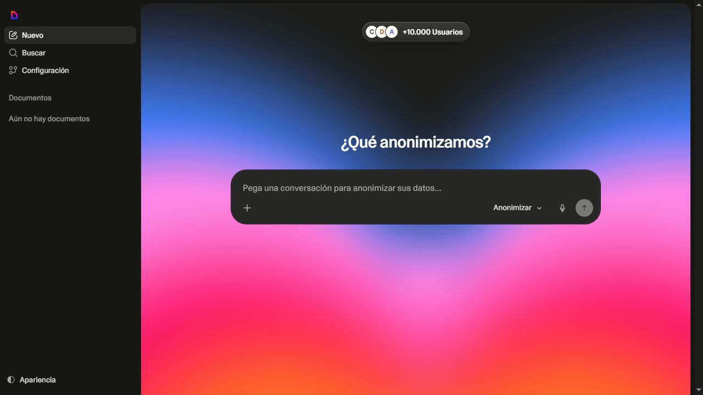
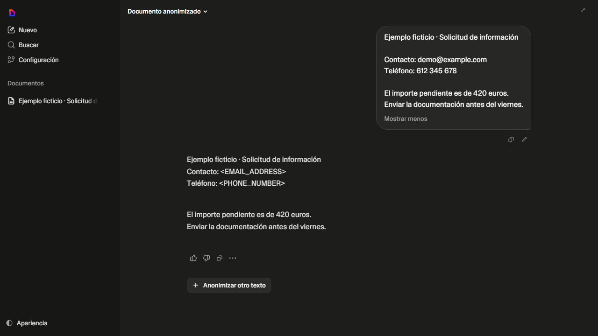
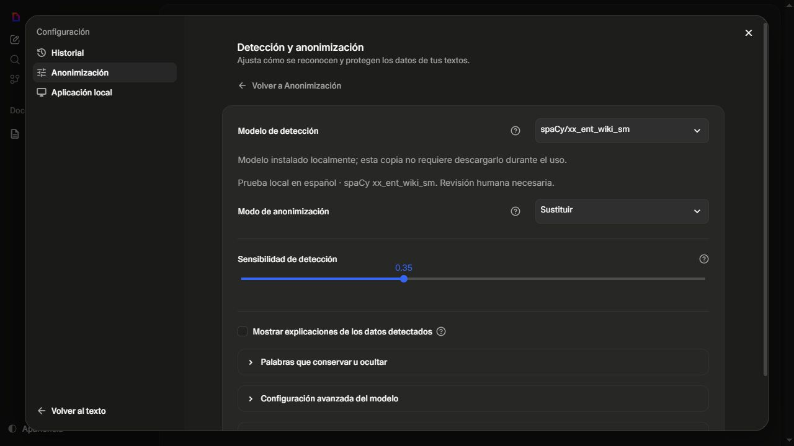

**English** | [Español](README.es.md)

# Anonymizer

**Review your text before sharing it.**

A Windows app that helps detect and replace identifying information in **Spanish-language text**. Paste, review and copy the result, with the engine running on your computer.

**The app interface and supported text workflow are in Spanish.** This English README introduces the project to an international audience.

**[Download for Windows x64 →](https://github.com/guillemarcos14/Anonymizer/releases/download/v0.3.0/Anonimizar-Setup-0.3.0-win-x64.exe)**

Pre-release **0.3.0** · Engine and model included · No app account required

[Release notes](https://github.com/guillemarcos14/Anonymizer/releases/tag/v0.3.0) · [Check SHA-256](https://github.com/guillemarcos14/Anonymizer/releases/download/v0.3.0/Anonimizar-Setup-0.3.0-win-x64.exe.sha256)

*The actual home screen, before entering any text. The screenshots retain the Spanish interface.*

*Real screenshot with fictional data. In this example, the email address and phone number are replaced; the amount and instructions are preserved. Every output requires human review.*

## What you can do

- **Prepare a copy of your text:** detect and replace identifiers such as email addresses and phone numbers using Presidio.
- **Review before sharing:** consult the original and the result, check substitutions, and copy or download the output.
- **Return to saved documents:** recover the original and its review from local history, export backups and manage the trash.
- **Adjust detection:** choose the anonymization mode, sensitivity, and words to keep or hide.

*The controls let you adjust processing; their availability does not guarantee correct detection of every data type.*

## Install and get started

**Requirements:** Windows x64 and .NET Framework 4.6.2 or later. The installer includes Python, dependencies and the model; you do not need to install them separately or use a terminal.

1. **[Download the Windows installer](https://github.com/guillemarcos14/Anonymizer/releases/download/v0.3.0/Anonimizar-Setup-0.3.0-win-x64.exe)** and run it. Confirm installation for your Windows user.
2. **Open Anonimizar** from the desktop or Start menu. The interface opens in your browser and the engine runs on your computer.
3. **Paste Spanish text, submit it and review the result.** Check for omissions and incorrect substitutions before copying or sharing it. Provisional limit: **10,000 characters**.

The installer **is not signed with a publisher certificate**; Windows may display a warning. You can compare its hash with the [release SHA-256 file](https://github.com/guillemarcos14/Anonymizer/releases/download/v0.3.0/Anonimizar-Setup-0.3.0-win-x64.exe.sha256). A checksum verifies integrity; it does not replace a publisher signature.

To stop the engine, use **Configuración → Cerrar Anonimizar y detener el motor** in the Spanish interface. Closing the browser tab alone leaves it running.

## Privacy and limitations

- **Local processing:** the engine runs on your computer. This is not a universal guarantee of no external connections; see [usage and privacy](USAGE.md).
- **History is enabled by default:** it stores the original, settings and review in `%LOCALAPPDATA%\Anonimizar`. You can disable it in Settings; doing so does not delete existing documents. There is no application-provided encryption of local history.
- **Human review is required:** omissions, false positives and indirect identifying details may remain. Complete or irreversible anonymization is not guaranteed.
- **Pre-release:** checked with fictional data on one Windows computer, including isolated installation, the model, history, uninstallation and reinstallation. Standard Windows integration, native dialogs and another computer still need validation.

The code is public. A project-wide license for the project's own contributions and permissions for some visual resources are still unresolved; existing attributions and conditions remain in place. See [licenses and attributions (Spanish)](LICENCIAS.md), [conditions (Spanish)](CONDICIONES-ENTREGA.md) and [validation status (Spanish)](PREPARACION.md).

## Development and documentation

<strong>Run from source and build the installer</strong>

**CPython 3.13.7 x64** is required. From PowerShell in the repository directory:

~~~powershell
.\descargar-dependencias.ps1 -Python 'C:\path\Python313\python.exe'
.\instalar.ps1 -Python 'C:\path\Python313\python.exe'
.\iniciar.ps1
~~~

The download fetches pinned dependencies and the model from public sources and verifies their hashes. Installation then uses the local kit and creates `.venv`; it does not overwrite an existing environment.

To build, with that environment installed and the Windows .NET Framework compiler available:

~~~powershell
.\.venv\Scripts\python.exe -B packaging\build_local.py
~~~

The `wheelhouse/` packages, environment, local evidence and generated executables are excluded from Git. The installer is distributed through GitHub Releases.

Usage and installation guides are available in both languages. Installer build notes, validation records and attributions are currently in Spanish.

| Guide | Contents |
|---|---|
| [Using the app](USAGE.md) · [Español](LOCAL.md) | History, privacy, recovery and shutdown |
| [Installing from source](INSTALLATION.md) · [Español](INSTALACION.md) | Public dependencies, hashes and offline installation |
| [Installer build and tests](INSTALADOR.md) | Packaging and the isolated installation/uninstallation cycle |
| [Status and remaining work](PREPARACION.md) | What has been checked and what still needs validation |
| [Attributions and history](avisos/historico-producto/README.md) | Preserved background; third-party notices are in `avisos/` |
